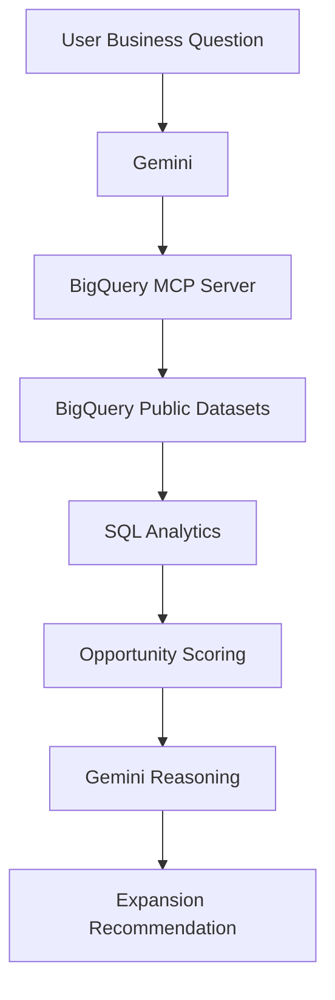

# CoffeeRide AI — System Architecture Specification

## Architecture Overview

CoffeeRide AI combines Gemini reasoning with BigQuery Model Context Protocol (MCP) and public mobility datasets to transform urban bicycle traffic into store expansion intelligence.

---

## Component Roles & Responsibilities

### 1. User (Business Intent Input)
The operator enters business expansion constraints (e.g. Target Market: *New York City*, Market Type: *Cyclist-focused coffee shop*).

### 2. Gemini (Reasoning & Orchestration)
Acts as the cognitive layer. Gemini interprets the expansion objective, determines required mobility signals, and invokes the BigQuery MCP tool interface using structured parameters.

### 3. BigQuery MCP Server (Standardized Data Access)
Provides an open Model Context Protocol (MCP) interface allowing Gemini to securely inspect schemas and execute analytical SQL queries against BigQuery without custom API wrappers.

### 4. BigQuery Public Datasets (Raw Mobility Source)
Target datasets (`bigquery-public-data.new_york.citibike_trips` and `bigquery-public-data.new_york.citibike_stations`) housing anonymized trip logs, station locations, and docking capacities.

### 5. SQL Analytics (Spatial Aggregation)
Executes aggregation queries calculating spatial trip origin density, destination docking convergence, and peak commuter hour ratios across urban corridors.

### 6. Opportunity Scoring (COI Engine)
Calculates the normalized Cyclist Opportunity Score (0–100) using weighted factors: 50% cycling activity, 25% trip starts, 15% trip ends, and 10% activity consistency.

### 7. Gemini Reasoning (Commercial Synthesis)
Gemini interprets the aggregated SQL scores, evaluates business suitability, and formulates strategic location drivers.

### 8. Expansion Recommendation (Ranked Output)
Renders top candidate corridors (e.g. #1 Downtown Brooklyn [91/100]) with actionable decision support in the frontend dashboard.
